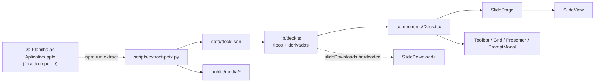

# Escaneamento do projeto — harve-aula

> Data: 2026-10-02 · Branch analisada: último commit `565f627 feature: agents`

## 1. O que é

Apresentação web **"Da Planilha ao Aplicativo"** (Harve TI & Dados): uma versão fiel, slide a slide, de um PPTX, com recursos extras para a aula, como copiar prompts, abrir prompts em tela cheia, modo apresentador e downloads da planilha-modelo.

- **Sem backend e sem banco de dados**: o site é 100% estático e o conteúdo vem de `data/deck.json`.
- **Deploy-alvo:** Vercel.

## 2. Stack

| Camada | Tecnologia |
|---|---|
| Framework | Next.js **16.3.2** (App Router). Tem APIs diferentes das versões anteriores; ver `AGENTS.md` |
| UI | React **19.2.8** |
| Estilo | Tailwind CSS **4** (via `@tailwindcss/postcss`) |
| Linguagem | TypeScript 5.9 |
| Extração de conteúdo | Python 3 (`scripts/extract-pptx.py`) |
| Dependências de runtime | Apenas `next`, `react` e `react-dom` |

## 3. Estrutura

```
app/
  layout.tsx            # fontes (Nunito, Titillium, Roboto Mono) + metadata
  page.tsx              # "/"  -> <Deck initial={1} />
  slide/[n]/page.tsx    # "/slide/N" estático (generateStaticParams, dynamicParams=false)
  not-found.tsx
components/
  Deck.tsx              # orquestrador: estado, teclado, swipe, URL (284 linhas)
  SlideStage.tsx        # escala o palco 960x540 por transform
  SlideView.tsx         # renderiza shapes/imagens/texto em coordenadas absolutas
  Toolbar.tsx, SlideGrid.tsx, Thumb.tsx, PresenterPanel.tsx, HelpOverlay.tsx
  PromptModal.tsx, CodeBlockControls.tsx, SlideDownloads.tsx
lib/
  deck.ts               # tipos do deck.json, fontes, detecção de blocos de código, placeholders 【】, downloads
  useCopy.ts            # hook de clipboard
data/deck.json          # 36 slides, palco 960x540 (gerado pelo script)
public/media/           # 42 imagens (~3,3 MB)
public/clientes-modelo.{csv,xlsx}
scripts/extract-pptx.py # PPTX -> deck.json + mídia
.claude/agents/         # arquiteto-de-sistema, especialista-negocio, dba, techlead
docs/                   # este documento
```

Tamanho aproximado do código: cerca de 2.000 linhas (TSX/TS/Python).

## 4. Fluxo de dados



Decisões que já estão no código:
- **Palco fixo de 960×540 escalado por `transform`**: as quebras de linha ficam iguais em qualquer tela e o texto continua vetorial.
- **Blocos de código são detectados por heurística**: o texto inteiro precisa estar em Consolas e ter 20 caracteres ou mais. A partir de 5 linhas, o bloco também pode ser aberto em tela cheia.
- **Os downloads ficam fora do `deck.json`** porque esse arquivo é sobrescrito pelo script. Eles estão definidos em `lib/deck.ts`.
- **Uma rota estática por slide** (`/slide/1` a `/slide/36`).

## 5. Funcionalidades

- Navegação por teclado: setas, espaço, N/P, Home/End, número + Enter.
- Navegação por swipe em telas de toque.
- Grade de slides (G), tela cheia (F) e ajuda (?).
- Modo apresentador (A) com cronômetro (T) e prévia do próximo slide.
- Prompts: copiar (C), copiar sem `【】` (Shift+C), tela cheia (E) e destaque dos placeholders (B).
- Download do CSV e do XLSX modelo no slide 15.
- Títulos de página por slide (`generateMetadata`).

## 6. Achados e pontos de atenção

| # | Severidade | Achado | Sugestão |
|---|---|---|---|
| 1 | Média | `public/teste2.html` é um arquivo de teste, está modificado sem commit e é **publicado no site** (`/teste2.html`). O conteúdo atual são anotações sobre o agente. | Remover o arquivo, ou mover as anotações para o `GUIA-AGENTES.md` |
| 2 | Média | O script `"lint": "next lint"`: o comando `next lint` foi removido no Next 16, então o script provavelmente falha. Não há ESLint configurado. | Configurar ESLint CLI (flat config) ou remover o script |
| 3 | Média | O README fala na subpasta `deck-harve/` e no repositório `harve/`, mas o projeto está na raiz de `harve-aula`. | Atualizar a seção "Publicar na Vercel" |
| 4 | Baixa | O `npm run extract` depende de `../Da Planilha ao Aplicativo.pptx`, que fica **fora do repositório**. Sem esse arquivo, o deck não pode ser regenerado. | Documentar a origem do PPTX ou versioná-lo (por exemplo, em `.pptx-src/`, hoje ignorado) |
| 5 | Baixa | Não há testes nem CI. As heurísticas de `lib/deck.ts` (título, rótulo de bloco, placeholders) são frágeis a mudanças no PPTX. | Adicionar testes unitários leves para `lib/deck.ts` e um `next build` em CI |
| 6 | Baixa | `node_modules` não está instalado no diretório, então os docs do Next em `node_modules/next/dist/docs/` (exigidos pelo `AGENTS.md`) estão indisponíveis. | Rodar `npm install` antes de qualquer alteração de código |
| 7 | Baixa | As imagens ficam em `public/media` (~3,3 MB) e as 42 são servidas sem otimização (a renderização é absoluta, sem `next/image`). | Aceitável para a aula. Se necessário, comprimir os JPG/PNG |
| 8 | Info | Os commits recentes têm mensagens pouco descritivas ("deletre", "subindo teste2"). | Padronizar as mensagens (por exemplo, Conventional Commits) |
| 9 | Info | A pasta `.claude/` (agentes) não está no Git. | Fazer commit se o time for compartilhar os agentes |

## 7. Estado do Git

- 9 commits no histórico.
- Modificado: `public/teste2.html`.
- Não versionado: `.claude/`.

## 8. Próximos passos sugeridos (sem over-engineering)

1. Limpar o `teste2.html` e corrigir o README (itens 1 e 3).
2. Corrigir o script de lint (item 2).
3. Adicionar uma CI mínima (`npm ci && npm run build`) e alguns testes de `lib/deck.ts` (item 5).
4. Definir onde o PPTX-fonte fica guardado (item 4).
