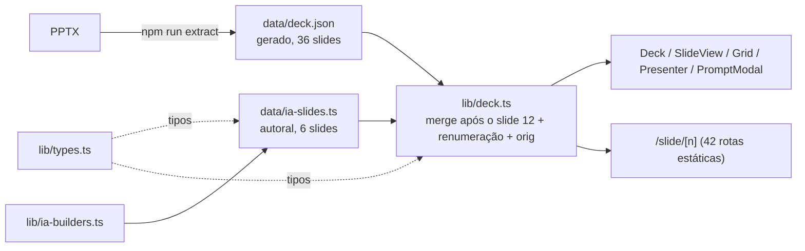

# 02 — Arquitetura: módulo "Como usar IA"

## Visão geral
É um monolito estático (Next.js, saída 100% estática). Os slides do módulo são **dados autorais em TypeScript**, no mesmo formato dos slides extraídos do PPTX. Eles são mesclados ao deck em `lib/deck.ts`. Toda a UI existente funciona sem mudança: palco, grade, apresentador, copiar e tela cheia.

## Componentes
| Componente | Responsabilidade |
|---|---|
| `lib/types.ts` | Tipos do deck (`Slide` ganha o campo `orig?`, com o número no PPTX) |
| `lib/ia-builders.ts` | Helpers puros (`title`, `lead`, `paragraph`, `bullets`, `heading`, `promptBox`, `card`, `slide`) em px do palco |
| `data/ia-slides.ts` | Conteúdo e notas dos 6 slides |
| `lib/deck.ts` | Mescla os slides, renumera, expõe `finalN(orig)` e indexa os downloads pela origem |

## ADRs
- **ADR-01: integrado ao deck.** O módulo são 6 slides no palco 960×540, inseridos depois do slide 12. A página separada `/ia` foi descartada a pedido do usuário. *Trade-off:* os slides de 13 a 36 mudam de número, e links antigos `/slide/N` passam a apontar para outro slide.
- **ADR-02: conteúdo autoral em TS, fora do `deck.json`.** O `deck.json` é sobrescrito pelo extract, então não pode receber edição manual. Os builders evitam escrever coordenadas cruas. *Trade-off:* o layout não é medido, então pode haver transbordo de texto, verificado visualmente.
- **ADR-03: renumeração por origem.** Cada slide do PPTX guarda `orig`. As referências fixas (`slideDownloads`) usam `orig`, e `finalN(orig)` converte para o número final. Rotas e `codeBlocks` derivam de `slides` e se ajustam sozinhos.
- **ADR-04: sem dependências novas.** O lint (`next lint`, removido no Next 16) fica fora do escopo. A validação é feita por `tsc`, `build` e conferência visual.
- **ADR-05: reaproveitar as heurísticas.** Um prompt é detectado quando o texto inteiro está em Consolas e tem 20 caracteres ou mais. O rótulo vem de um heading em Titillium bold até 90px acima do bloco. Os builders seguem essas regras em vez de mudá-las.
- **ADR-06: segundo deck em `/next`, vindo do PDF.** O PDF "React com Next.js e IA" (187 páginas) é servido em `/next` e `/next/slide/[n]`. Cada página vira uma imagem WebP (1920×1080) que ocupa o palco inteiro, e sobre os cartões de código, prompt e comando ficam áreas invisíveis com os botões de copiar e de tela cheia. *Trade-off:* a fidelidade visual é total, mas o texto do fundo não pode ser selecionado e o site fica 13 MB maior.
- **ADR-07: um motor e várias fontes.** O `Deck` recebe um `DeckSource` (`basePath`, `mediaPath`, slides, blocos) pelo contexto, e os componentes importam só de `lib/deck-core.ts`. Assim o JSON de um deck não entra no bundle do outro e não é preciso duplicar `Deck.tsx`.
- **ADR-08: texto copiável curado à mão.** A fonte JetBrains Mono do PDF corrompe as ligaduras na extração (`//`, `=>`, `||`…). Por isso o texto copiado vem só de `data/next-code-overrides.json`, que o extrator nunca sobrescreve, e um bloco sem correção fica sem botão. *Trade-off:* quando o PDF mudar, os blocos precisam ser revisados.

## Segurança, escala e observabilidade
- Não se aplicam: o site é estático, não coleta dados e não tem segredos.
- O único cuidado de segurança é o conteúdo: os exemplos usam só dados fictícios (RN02).
