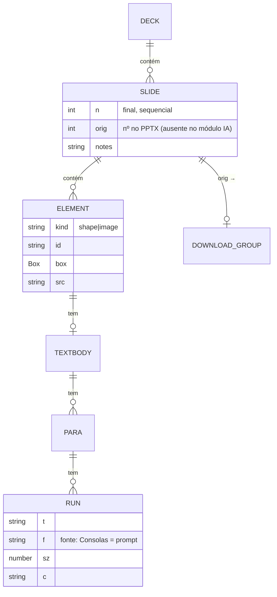

# 03 — Dados

**Não há banco de dados.** Os "dados" do projeto são o conteúdo dos slides, versionado no repositório. Por isso o DBA não foi acionado.

## Fontes
| Fonte | Origem | Editável à mão? |
|---|---|---|
| `data/deck.json` | Gerado por `scripts/extract-pptx.py` | Não |
| `data/ia-slides.ts` | Autoral (módulo IA) | Sim |
| `lib/deck.ts` → `slideDownloads` | Autoral (indexado por `orig`) | Sim |
| `public/clientes-modelo.{csv,xlsx}` | Planilha-modelo fictícia | Sim |

## Modelo

## Regras de integridade
- `n` é sequencial de 1 a 42 depois da mescla. `orig` é único entre os slides do PPTX.
- Um elemento de prompt precisa de `id` único no slide e de todo o texto em Consolas.
- `finalN(orig)` precisa encontrar o slide. Se o PPTX mudar, revisar `INSERT_AFTER = 12`.
