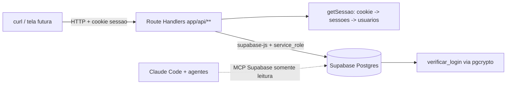

# 02 — Arquitetura: deck `/mcp` e projeto "Lojinha da Marina"

São dois sistemas: (A) o **deck** neste repositório e (B) o **projeto do aluno**, que os prompts dos slides mandam construir.

## A. Deck `/mcp` (neste repositório)
- Usa o mesmo motor dos outros decks (`Deck` + `DeckSource`). O conteúdo é só dados em `lib/mcp-content.ts`, o layout reaproveita o builder do `/agentes` e o kit de agentes fica em `public/mcp-kit/*.md`.
- Rotas estáticas `/mcp` e `/mcp/slide/[n]` (`generateStaticParams` com `dynamicParams = false`).
- O `/agentes` não pode mudar visualmente.

## B. Projeto do aluno
Monolito Next.js: os Route Handlers são a única porta de entrada e o Supabase Postgres guarda os dados.

### Componentes
| Componente | Responsabilidade |
|---|---|
| `app/api/health` | Checa se o app e o banco respondem |
| `app/api/auth/*` | Login (RPC `verificar_login` e cria a sessão), logout e me |
| `app/api/produtos/**` | CRUD do lojista e listagem por papel |
| `app/api/carrinho/**` | Carrinho do cliente |
| `lib/supabase.ts` | Cliente supabase-js com a service_role, **só no servidor** |
| `lib/sessao.ts` | `getSessao()` e helpers que exigem um papel e devolvem 401 ou 403 |
| MCP Supabase | O Claude inspeciona schema e dados em modo **read_only** |

### Segurança
- A service_role só fica em `.env.local`, nunca no git nem no cliente. A RLS fica ligada em todas as tabelas, sem policies (a anon key não lê nada).
- A senha é guardada com hash bcrypt (pgcrypto) e verificada dentro do banco. O cookie `sessao` é httpOnly e SameSite=Lax, com expiração.
- A identidade e o papel vêm só da sessão (RN11). Recurso de outro usuário devolve 404, para não vazar que ele existe.
- O MCP do banco fica com `read_only=true` e `project_ref` fixo. Nunca aponte para produção.

### Observabilidade (MVP)
`/api/health`, respostas de erro em JSON `{ erro: "mensagem" }` com os status da RN12, e logs do servidor no terminal do `npm run dev`.

## ADRs
- **ADR-01. Supabase como banco.** Tem MCP oficial, não exige instalação e a aula anterior já usou. Trade-off: depende de conta e internet.
- **ADR-02. Login com tabelas próprias, não Supabase Auth.** Pedido do professor: é mais didático ver usuário, senha e sessão no banco. O hash fica no Postgres (pgcrypto), para o aluno não ter que implementar criptografia. Trade-off: é menos seguro que um provedor pronto, então fica explícito que serve só para a aula.
- **ADR-03. Tudo via Route Handlers `/api`, sem Server Actions.** Uma porta única de regras, testável com curl e que serve qualquer front. Trade-off: mais código que Server Actions.
- **ADR-04. supabase-js com service_role e RLS sem policies.** Como a auth é própria, a RLS do Supabase não conhece o usuário. A autorização fica no Route Handler e a RLS só bloqueia a anon key. Trade-off: um bug na rota vaza dados, e por isso existem os testes de permissão do QA.
- **ADR-05. SQL puro, sem ORM.** Menos conceitos para o aluno; o SQL aparece nos slides e roda no SQL Editor.
- **ADR-06. Prompt único para os 7 agentes, em 2 slides.** Cumpre o "um prompt para todos" sem estourar o cartão de prompt (~2400 caracteres).
- **ADR-07. Deck sem tipos novos de slide, salvo se for indispensável.** Reuso máximo do motor do `/agentes`.
