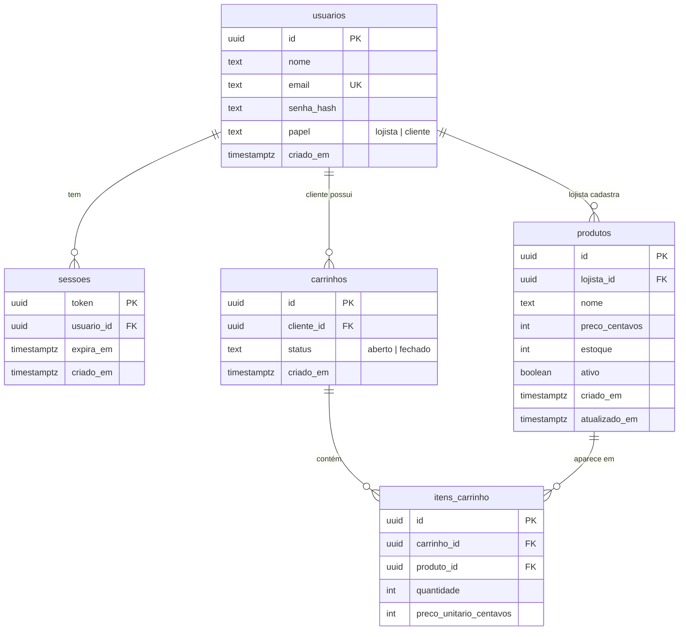

# Dados do projeto "Lojinha da Marina" (deck `/mcp`)

Banco: **Supabase (Postgres 15+)**. Sem ORM: SQL puro na migração e `supabase-js` nas rotas `/api/...` (service_role só no servidor). Nomes em português, `snake_case`, tabelas no plural.

## 1. Escolha do banco

Postgres (Supabase), decisão do arquiteto. Motivos que valem na aula:

- É relacional: carrinho, item, produto e usuário têm vínculos claros, e quem vem do Excel já entende "tabela com linhas e colunas" e "PROCV" (que aqui vira chave estrangeira).
- `CHECK`, `UNIQUE` e índice único parcial deixam o próprio banco recusar dado inválido (RN04, RN07, RN08).
- Trade-off: um banco de documentos (Mongo) seria mais simples para um catálogo solto, mas perderíamos as garantias acima e o carrinho viraria um documento difícil de proteger de duplicidade.

PK: **uuid** (`gen_random_uuid()`, nativo desde o Postgres 13, sem extensão). Motivo: o id aparece na URL e no cookie/JSON, e uuid não é adivinhável (`/api/produtos/3` seria). Custo: mais longo de ler; para os slides usamos selects por e-mail ou nome.

## 2. Modelo conceitual



## 3. Dicionário de dados

### usuarios

| Coluna | Tipo | Restrição | Motivo |
|---|---|---|---|
| id | uuid | PK, default `gen_random_uuid()` | Identificador não adivinhável |
| nome | text | NOT NULL | Exibição |
| email | text | NOT NULL, UNIQUE, CHECK minúsculo | Login; forçar minúsculo evita `Marina@` e `marina@` como contas diferentes |
| senha_hash | text | NOT NULL | Hash bcrypt; a senha em texto nunca é gravada |
| papel | text | NOT NULL, CHECK `lojista`/`cliente` | RN01: exatamente 1 papel |
| criado_em | timestamptz | NOT NULL, default `now()` | Auditoria |

### sessoes

| Coluna | Tipo | Restrição | Motivo |
|---|---|---|---|
| token | uuid | PK, default `gen_random_uuid()` | Valor do cookie httpOnly (122 bits aleatórios) |
| usuario_id | uuid | NOT NULL, FK usuarios, ON DELETE CASCADE | Apagou o usuário, somem as sessões |
| expira_em | timestamptz | NOT NULL, default `now() + 7 dias` | Sessão com validade |
| criado_em | timestamptz | NOT NULL, default `now()` | Auditoria |

### produtos

| Coluna | Tipo | Restrição | Motivo |
|---|---|---|---|
| id | uuid | PK | Identificador |
| lojista_id | uuid | NOT NULL, FK usuarios | RN02/RN03: de quem é o produto |
| nome | text | NOT NULL, CHECK 3 a 80 caracteres | RN04 |
| preco_centavos | integer | NOT NULL, CHECK > 0 | RN04; centavos inteiros evitam erro de arredondamento de decimal/float |
| estoque | integer | NOT NULL, default 0, CHECK >= 0 | RN04/RN05: 0 significa esgotado |
| ativo | boolean | NOT NULL, default true | RN04/RN06: esconde do cliente sem apagar |
| criado_em / atualizado_em | timestamptz | NOT NULL, default `now()` | Auditoria (a rota atualiza `atualizado_em`) |

### carrinhos

| Coluna | Tipo | Restrição | Motivo |
|---|---|---|---|
| id | uuid | PK | Identificador |
| cliente_id | uuid | NOT NULL, FK usuarios | Dono do carrinho |
| status | text | NOT NULL, default `aberto`, CHECK `aberto`/`fechado` | RN07 |
| criado_em | timestamptz | NOT NULL, default `now()` | Auditoria |

### itens_carrinho

| Coluna | Tipo | Restrição | Motivo |
|---|---|---|---|
| id | uuid | PK | Identificador |
| carrinho_id | uuid | NOT NULL, FK carrinhos, ON DELETE CASCADE | Item não existe sem carrinho |
| produto_id | uuid | NOT NULL, FK produtos | Qual produto |
| quantidade | integer | NOT NULL, CHECK >= 1 | RN08 (o teto, o estoque, é checado na função) |
| preco_unitario_centavos | integer | NOT NULL, CHECK > 0 | RN09: preço congelado no momento da adição |
| (carrinho_id, produto_id) | | UNIQUE | RN08: mesmo produto soma quantidade, não duplica linha |

## 4. Migração SQL (rodar nesta ordem)

Cada bloco cabe em um cartão de slide. O bloco 8 é longo e está dividido em duas partes de slide (8a e 8b), mas **roda como um único comando**.

### Bloco 1: extensão

```sql
-- 1) Extensão para criptografar senhas (bcrypt).
-- No Supabase ela vive no schema "extensions".
create extension if not exists pgcrypto with schema extensions;
```

### Bloco 2: usuarios

```sql
-- 2) Usuários: lojista (Marina) e clientes (Carlos)
create table public.usuarios (
  id         uuid primary key default gen_random_uuid(),
  nome       text not null,
  email      text not null unique check (email = lower(email)),
  senha_hash text not null,          -- hash bcrypt, nunca a senha pura
  papel      text not null check (papel in ('lojista', 'cliente')),
  criado_em  timestamptz not null default now()
);
```

### Bloco 3: sessoes

```sql
-- 3) Sessões: o token vai no cookie httpOnly
create table public.sessoes (
  token      uuid primary key default gen_random_uuid(),
  usuario_id uuid not null references public.usuarios (id) on delete cascade,
  expira_em  timestamptz not null default now() + interval '7 days',
  criado_em  timestamptz not null default now()
);
```

### Bloco 4: produtos

```sql
-- 4) Produtos (cada um pertence a um lojista)
create table public.produtos (
  id             uuid primary key default gen_random_uuid(),
  lojista_id     uuid not null references public.usuarios (id),
  nome           text not null check (char_length(nome) between 3 and 80),
  preco_centavos integer not null check (preco_centavos > 0),
  estoque        integer not null default 0 check (estoque >= 0),
  ativo          boolean not null default true,
  criado_em      timestamptz not null default now(),
  atualizado_em  timestamptz not null default now()
);
```

### Bloco 5: carrinhos e itens

```sql
-- 5) Carrinhos e itens
create table public.carrinhos (
  id         uuid primary key default gen_random_uuid(),
  cliente_id uuid not null references public.usuarios (id),
  status     text not null default 'aberto' check (status in ('aberto', 'fechado')),
  criado_em  timestamptz not null default now()
);

create table public.itens_carrinho (
  id                      uuid primary key default gen_random_uuid(),
  carrinho_id             uuid not null references public.carrinhos (id) on delete cascade,
  produto_id              uuid not null references public.produtos (id),
  quantidade              integer not null check (quantidade >= 1),
  preco_unitario_centavos integer not null check (preco_unitario_centavos > 0),
  unique (carrinho_id, produto_id)   -- RN08: mesmo produto soma, não repete
);
```

### Bloco 6: índices

```sql
-- 6) Índices
-- RN07: no máximo 1 carrinho ABERTO por cliente
create unique index carrinho_aberto_unico
  on public.carrinhos (cliente_id) where status = 'aberto';

-- "meus produtos" do lojista
create index produtos_lojista_idx on public.produtos (lojista_id);

-- sessões de um usuário (logout geral, limpeza)
create index sessoes_usuario_idx on public.sessoes (usuario_id);

-- quais itens usam este produto (FK sem índice fica lenta)
create index itens_produto_idx on public.itens_carrinho (produto_id);
```

### Bloco 7: RLS e permissões

```sql
-- 7) Segurança: liga a RLS em TODAS as tabelas, sem nenhuma policy.
-- Resultado: a anon key não lê nada. A service_role ignora a RLS.
alter table public.usuarios       enable row level security;
alter table public.sessoes        enable row level security;
alter table public.produtos       enable row level security;
alter table public.carrinhos      enable row level security;
alter table public.itens_carrinho enable row level security;

-- Reforço: tira também o acesso direto às tabelas
revoke all on all tables in schema public from anon, authenticated;
```

### Bloco 8a: verificar_login (função de login)

```sql
-- 8a) Login: confere a senha DENTRO do banco; o hash nunca sai.
-- Devolve 1 linha (id, nome, papel) se acertou, 0 linhas se errou.
create or replace function public.verificar_login(p_email text, p_senha text)
returns table (id uuid, nome text, papel text)
language sql
stable
security definer
set search_path = ''
as $$
  select u.id, u.nome, u.papel
  from public.usuarios u
  where u.email = lower(p_email)
    and u.senha_hash = extensions.crypt(p_senha, u.senha_hash);
$$;

-- Só o servidor (service_role) pode chamar (veja a seção 9)
revoke execute on function public.verificar_login(text, text) from public, anon, authenticated;
grant  execute on function public.verificar_login(text, text) to service_role;
```

### Bloco 8b: adicionar_ao_carrinho, parte 1 (opcional, validações)

Roda junto com a parte 2 como um único `create function`.

```sql
-- 8b) (Opcional) Adiciona ao carrinho de forma atômica: RN05, RN07, RN08, RN09
create or replace function public.adicionar_ao_carrinho(
  p_cliente_id uuid, p_produto_id uuid, p_qtd integer)
returns uuid                       -- devolve o id do carrinho
language plpgsql
security definer
set search_path = ''
as $$
declare
  v_produto  public.produtos;
  v_carrinho uuid;
  v_no_carrinho integer;
begin
  if p_qtd is null or p_qtd < 1 then
    raise exception 'Quantidade deve ser um inteiro maior que zero';
  end if;
  if not exists (select 1 from public.usuarios
                 where id = p_cliente_id and papel = 'cliente') then
    raise exception 'Apenas clientes possuem carrinho';
  end if;

  -- trava a linha do produto enquanto calculamos (evita corrida)
  select * into v_produto from public.produtos
   where id = p_produto_id and ativo for share;
  if not found then
    raise exception 'Produto não encontrado';
  end if;
  if v_produto.estoque = 0 then
    raise exception 'Produto esgotado';                          -- RN05
  end if;
```

### Bloco 8c: adicionar_ao_carrinho, parte 2 (gravação)

```sql
  -- RN07: cria o carrinho aberto no primeiro item (ou reaproveita)
  insert into public.carrinhos (cliente_id) values (p_cliente_id)
  on conflict (cliente_id) where status = 'aberto' do nothing;

  select id into v_carrinho from public.carrinhos
   where cliente_id = p_cliente_id and status = 'aberto';

  select quantidade into v_no_carrinho from public.itens_carrinho
   where carrinho_id = v_carrinho and produto_id = p_produto_id;

  -- RN08: soma, mas sem passar do estoque
  if coalesce(v_no_carrinho, 0) + p_qtd > v_produto.estoque then
    raise exception 'Estoque insuficiente: disponível %, já no carrinho %',
      v_produto.estoque, coalesce(v_no_carrinho, 0);
  end if;

  -- RN09: o preço fica gravado na 1ª adição; RN10: não mexe no estoque
  insert into public.itens_carrinho
    (carrinho_id, produto_id, quantidade, preco_unitario_centavos)
  values (v_carrinho, p_produto_id, p_qtd, v_produto.preco_centavos)
  on conflict (carrinho_id, produto_id)
  do update set quantidade = public.itens_carrinho.quantidade + excluded.quantidade;

  return v_carrinho;
end;
$$;

revoke execute on function public.adicionar_ao_carrinho(uuid, uuid, integer) from public, anon, authenticated;
grant  execute on function public.adicionar_ao_carrinho(uuid, uuid, integer) to service_role;
```

(Os blocos 8b e 8c formam um só comando: do `create or replace function` até o `$$;` final. No slide, 8b termina em `end if;` e 8c continua dali.)

## 5. Seed

### Bloco 9: usuários

```sql
-- Seed 1/2: usuários (senha de demonstração: senha123)
-- gen_salt('bf') gera um sal diferente por linha
insert into public.usuarios (nome, email, senha_hash, papel) values
  ('Marina Souza', 'marina@loja.dev',
     extensions.crypt('senha123', extensions.gen_salt('bf')), 'lojista'),
  ('Carlos Lima',  'carlos@loja.dev',
     extensions.crypt('senha123', extensions.gen_salt('bf')), 'cliente')
on conflict (email) do nothing;
```

### Bloco 10: produtos da Marina

```sql
-- Seed 2/2: 5 produtos da Marina (rode UMA vez)
insert into public.produtos (lojista_id, nome, preco_centavos, estoque, ativo)
select u.id, p.nome, p.preco, p.estoque, p.ativo
from public.usuarios u
cross join (values
  ('Caneca de cerâmica', 4500,  20, true),
  ('Camiseta Harve',     7990,  15, true),
  ('Caderno artesanal',  3290,   8, true),
  ('Garrafa térmica',   11990,   0, true),   -- esgotado (RN05)
  ('Boné vintage',       5990,  10, false)    -- inativo (RN06)
) as p (nome, preco, estoque, ativo)
where u.email = 'marina@loja.dev';
```

## 6. Índices e justificativa

| Índice | Consulta que atende |
|---|---|
| `usuarios.email` UNIQUE (automático) | Login: `where email = ...` |
| `sessoes.token` PK (automático) | Cada requisição: achar a sessão pelo cookie |
| `carrinho_aberto_unico` (parcial, único) | Garante RN07 **e** serve para "carrinho aberto do cliente X" |
| `unique (carrinho_id, produto_id)` | Garante RN08 e serve para "itens do carrinho X" (prefixo `carrinho_id`) |
| `produtos_lojista_idx` | "Meus produtos" do lojista (RN06) |
| `sessoes_usuario_idx` | Apagar todas as sessões de um usuário |
| `itens_produto_idx` | Evita varredura ao checar/apagar produto referenciado |

O catálogo do cliente (`where ativo`) não tem índice dedicado: com dezenas de produtos, a varredura é instantânea. Índice aqui seria otimização prematura.

## 7. Regras de negócio: banco x aplicação

| RN | Onde | Como |
|---|---|---|
| RN01 papel único | Banco | Coluna `papel` NOT NULL + CHECK. Definido no seed; não há rota de cadastro |
| RN02/RN03 só o lojista cria/edita produtos, só os dele | **Aplicação** | Route Handler confere `papel = 'lojista'` e filtra `.eq('lojista_id', sessao.usuario_id)` em todo update. O banco só garante que `lojista_id` existe |
| RN04 validações do produto | Banco | CHECKs de nome, preço e estoque (a rota também valida, para devolver mensagem amigável) |
| RN05 esgotado não entra no carrinho | Função (ou rota) | Depende de outra tabela, não cabe em CHECK |
| RN06 cliente vê só ativos | **Aplicação** | `.eq('ativo', true)` na rota do cliente; lojista filtra por `lojista_id` |
| RN07 1 carrinho aberto por cliente | Banco | Índice único parcial; criação no 1º item feita pela função/rota |
| RN08 quantidade 1..estoque, soma | Banco + função | `quantidade >= 1` e UNIQUE no banco; teto do estoque na função/rota |
| RN09 preço congelado | Função/rota + banco | Coluna `preco_unitario_centavos` NOT NULL, preenchida na adição |
| RN10 adicionar não baixa estoque | Aplicação | Simplesmente não há `update` em `produtos` |

## 8. Função do carrinho ou lógica na rota? Recomendação

**Recomendo usar a função `adicionar_ao_carrinho` (via RPC).**

| | Função SQL (RPC) | Lógica no Route Handler |
|---|---|---|
| Atomicidade | Uma transação: sem corrida entre dois cliques | 4 a 5 chamadas separadas; dois cliques simultâneos podem passar do estoque ou duplicar o carrinho |
| Código da rota | ~5 linhas, só chama `supabase.rpc(...)` | ~40 linhas de ifs e queries |
| Mensagens de erro | Em um lugar só (`error.message`) | Espalhadas |
| Legibilidade para iniciante | Pior: PL/pgSQL é outra linguagem | Melhor: tudo em TypeScript |
| Depuração e versionamento | Mudar regra exige nova migração | Só editar o arquivo e recarregar |

Para a aula, a função se encaixa: o aluno já usou RPC no login (`verificar_login`), o Claude Code escreve e explica o PL/pgSQL, e a rota fica enxuta. O ponto de atenção é didático: mostrar a função como "regras do carrinho num lugar só" e mapear cada trecho para uma RN (os comentários já fazem isso). Se o tempo da aula for curto, o bloco 8b/8c pode ser pulado e a lógica pedida ao Claude Code na rota, ciente de que fica sujeita a corrida.

## 9. Consultas de verificação

```sql
-- Contagens esperadas: usuarios 2, produtos 5, ativos 4, esgotados 1
select
  (select count(*) from public.usuarios)                       as usuarios,
  (select count(*) from public.produtos)                       as produtos,
  (select count(*) from public.produtos where ativo)           as ativos,
  (select count(*) from public.produtos where estoque = 0)     as esgotados;
```

```sql
-- Todas as tabelas devem mostrar rls_ligada = true
select relname as tabela, relrowsecurity as rls_ligada
from pg_class
where relnamespace = 'public'::regnamespace and relkind = 'r'
order by relname;
```

```sql
-- Exemplo: produtos da Marina com o preço em reais
select p.nome,
       p.preco_centavos / 100.0 as preco_reais,
       p.estoque,
       p.ativo
from public.produtos p
join public.usuarios u on u.id = p.lojista_id
where u.email = 'marina@loja.dev'
order by p.nome;
```

```sql
-- Login: certa devolve 1 linha, errada devolve 0 linhas
select * from public.verificar_login('marina@loja.dev', 'senha123');
select * from public.verificar_login('marina@loja.dev', 'errada');
```

```sql
-- Testa o carrinho (rodando como dono no SQL Editor).
-- 1ª: ok. 2ª: soma para 4. Garrafa térmica: erro "Produto esgotado".
select public.adicionar_ao_carrinho(
  (select id from public.usuarios where email = 'carlos@loja.dev'),
  (select id from public.produtos where nome = 'Caneca de cerâmica'), 2);
select public.adicionar_ao_carrinho(
  (select id from public.usuarios where email = 'carlos@loja.dev'),
  (select id from public.produtos where nome = 'Caneca de cerâmica'), 2);

select p.nome, i.quantidade, i.preco_unitario_centavos
from public.itens_carrinho i join public.produtos p on p.id = i.produto_id;
```

## 10. Dados sensíveis e LGPD

- Pessoais: `usuarios.nome` e `usuarios.email`. Sensível em termos de segurança: `senha_hash` e `sessoes.token`.
- Senha: só bcrypt; `verificar_login` não devolve o hash e a RLS bloqueia a leitura direta. Limite do bcrypt: considera só os primeiros 72 bytes da senha.
- Token de sessão: guardado em texto (didático). Em produção, gravar o hash do token e comparar o hash.
- Dados da aula são fictícios (`@loja.dev`). Em produção real: política de retenção, apagar sessões expiradas e atender pedido de exclusão do titular.
- Limpeza de sessões expiradas: `delete from public.sessoes where expira_em < now();`

## 11. Operação

- Auditoria: `criado_em` em todas as tabelas, `atualizado_em` em `produtos`. Fica de fora `created_by` para manter curto; `produtos.lojista_id` e `carrinhos.cliente_id` já dizem quem é o dono.
- Exclusão: sem soft delete genérico. `produtos.ativo` faz o papel de "arquivar" e preserva o histórico dos itens (a FK impede apagar produto que está em carrinho).
- Backup: o Supabase faz backups diários nos planos pagos; no plano gratuito, o aluno pode usar `pg_dump` se quiser guardar. Não é tema da aula.
- Multitenancy: não há. Cada lojista isola seus produtos por `lojista_id`, aplicado na rota.
- Migração: o arquivo único `supabase/migrations/0001_lojinha.sql` (blocos 1 a 8c, mais seed em `seed.sql`). Rodado no SQL Editor ou pelo MCP do Supabase (`apply_migration`). Não há reexecução idempotente do conjunto inteiro: se errar, apagar com `drop table ... cascade` e rodar de novo.

## 12. Riscos e cuidados

1. **service_role nunca no cliente.** Ela ignora a RLS: quem a tiver lê e apaga tudo. Fica só em variável de ambiente do servidor, **sem** prefixo `NEXT_PUBLIC_`, e nunca no repositório (`.env.local` no `.gitignore`). Importar o cliente supabase com essa chave só em arquivos de Route Handler.
2. **Funções expostas por padrão.** No Supabase, toda função do schema `public` é chamável por RPC com a anon key, e a RLS **não** protege funções. Por isso os `revoke execute ... from public, anon, authenticated` dos blocos 8a e 8c são obrigatórios: sem eles, qualquer pessoa com a anon key (que é pública) poderia testar senhas no `verificar_login` ou mexer em qualquer carrinho.
3. **`security definer` sem `search_path` é brecha.** Por isso `set search_path = ''` e todos os nomes qualificados (`public.`, `extensions.`).
4. **Se `extensions.crypt` não existir** (erro `function extensions.crypt(text, text) does not exist` ou `schema "extensions" does not exist`):
   - Rode antes: `create extension if not exists pgcrypto with schema extensions;`. Se o schema não existir, `create schema if not exists extensions;` primeiro.
   - Veja onde ela está: `select extnamespace::regnamespace from pg_extension where extname = 'pgcrypto';`. Se for `public`, troque `extensions.crypt`/`extensions.gen_salt` por `public.crypt`/`public.gen_salt` nos blocos 8a e 9.
5. **Login e força bruta.** Não há limite de tentativas; fica fora do escopo da aula. Mencionar como próximo passo.
6. **RN02/03/06 só na aplicação.** Esquecer o `.eq('lojista_id', ...)` numa rota vaza ou altera dado alheio, porque a service_role ignora a RLS. Vale uma revisão (ou teste) por rota.
7. **`lojista_id` poderia apontar para um cliente.** O banco não impede (precisaria de trigger). Aceitável: só o seed cria usuários.
8. **Volume.** Dezenas de linhas na aula; nenhuma consulta pesada. Em escala, o primeiro gargalo seria listar produtos sem paginação.

## 13. Pontos ambíguos nos requisitos

- **RN08, estourar o estoque:** a função **recusa com erro** ("Estoque insuficiente") em vez de limitar silenciosamente ao estoque. Se preferirem limitar (clamp), trocar o `raise` por `least(...)`.
- **RN09 ao somar:** o preço do item é o da **primeira** adição; somar depois não atualiza o preço. Se o lojista mudar o preço entre as adições, o carrinho mantém o antigo.
- **Fechar carrinho (`fechado`):** não há fluxo de checkout nas RNs; o status existe só por causa do índice parcial da RN07.
- **Estoque que baixa depois da adição:** o item pode ficar com quantidade acima do estoque atual (RN10 não baixa). Não há checagem na visualização do carrinho; definir se a rota deve avisar.
